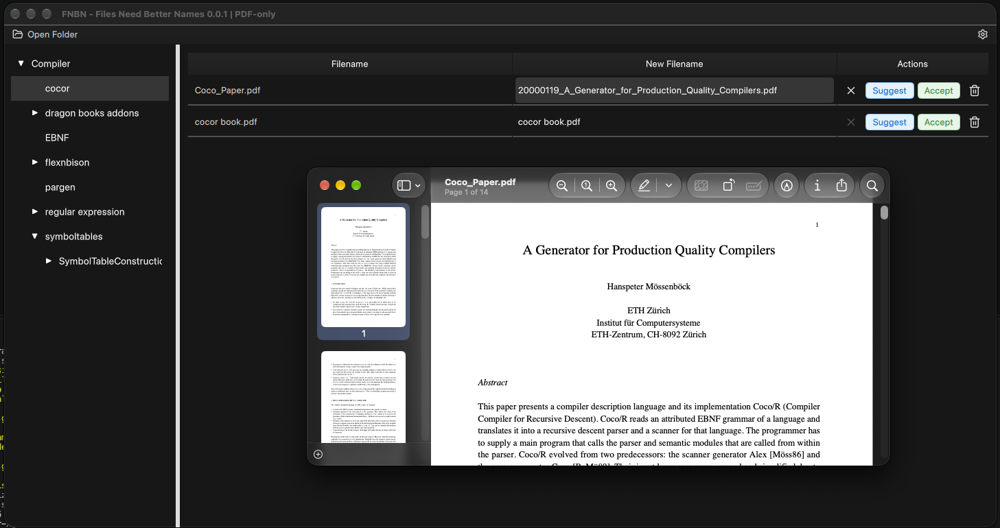

# FNBN - Files Need Better Names (0.0.1)
Rename your files with the help of a LLM.



## Setup

```shell
pip installe -e .
```

## Deploy

First time only
```shell
pyside6-deploy --init
```

```shell
pyside6-deploy --init
pyside6-deploy  
```

## Run

```shell
python main.py
```

```shell
fnbn-application
```

OSX
```shell
open FNBN.app
```

## Resources
* Icons: https://lucide.dev/icons/?utm_source=chatgpt.com